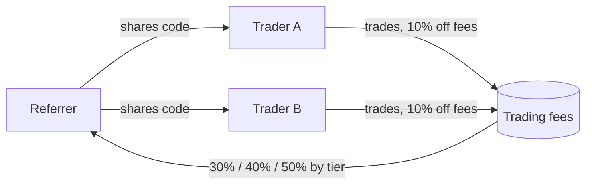
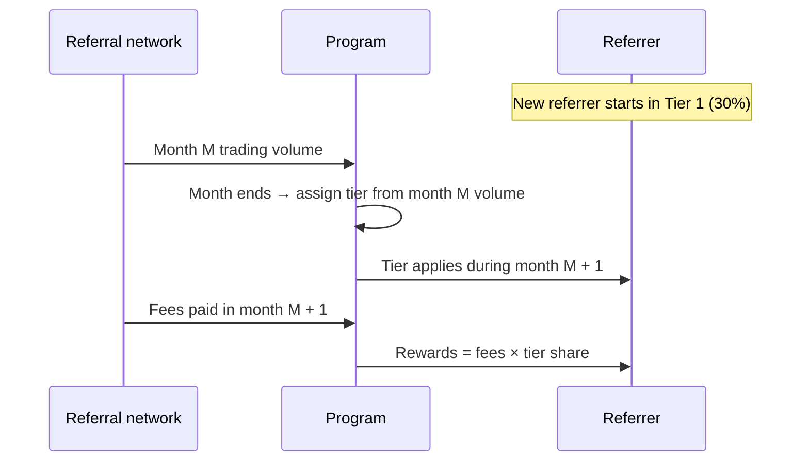

<p align="center">
  
</p>

# DYXY Referral program

How the DYXY referral program works: a 10% trading fee discount for invited traders, and 30% to 50% of their trading fees for referrers, with tiers set by monthly network volume.

> This repository describes how the program works. It does not contain DYXY source code. User guide: [docs.dyxy.io/referrals](https://docs.dyxy.io/referrals/overview).

## Overview



| | Referred trader | Referrer |
| --- | --- | --- |
| Benefit | 10% off all trading fees | 30%–50% of referred traders' fees |
| Applies to | Swaps, perps (incl. Degen mode), stocks, bots | All trades of the referral network |
| Condition | Link wallet to a code | Share a code |

Pools, staking and lending carry no DYXY fee, so they generate no referral rewards.

## Tiers

| Tier | Network volume in a calendar month | Referrer share |
| --- | --- | --- |
| 1 | $0 – $1M | **30%** |
| 2 | $1M – $10M | **40%** |
| 3 | Above $10M | **50%** |

## Monthly recalculation



- Volume counts every trade by every wallet linked to the code.
- The tier for each month is set by the previous month's volume.
- Tiers move up and down with volume.

## Formulas

```
trader fee paid   = standard fee × (1 − 10%)
referrer reward   = Σ trader fees paid × tier share
tier(month M+1)   = f(network volume in month M)
```

## Worked example

| Month | Network volume | Tier in force | Fees paid by network | Referrer earns |
| --- | --- | --- | --- | --- |
| May | $800K | 1 (30%) | — | — |
| June | $3M | 1 (30%), from May | $1,800 | $540 |
| July | $12M | 2 (40%), from June | $2,500 | $1,000 |
| August | — | 3 (50%), from July | — | — |

## Rules

| Rule | |
| --- | --- |
| Codes per wallet | One. The link is permanent |
| Self-referral | Not allowed |
| Both roles | A referred trader can also refer others |
| Claiming | Rewards accrue continuously and are claimed on the Referrals page |

## License

Text and diagrams in this repository are licensed under [CC BY 4.0](LICENSE). The DYXY name and logo are not covered by this license.
